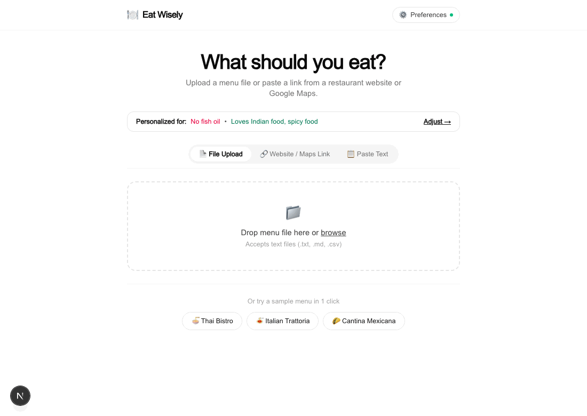

# 🍽️ Eat Wisely

An agentic menu scanner that tells you what to avoid and what you'll love, based on your allergies and taste profile.

Built as a capstone project for the [Agentic AI PM Certification](https://maven.com/mahesh-yadav/genaipm) (Cohort 11).



---

## The Problem

Picky eaters with dietary restrictions and allergies face decision fatigue every time they eat out. Reading long menus or checking items on delivery apps is exhausting, and missing a hidden ingredient (like fish sauce in Thai dishes or peanuts in satay) can ruin a meal or cause an allergic reaction.

---

## Features

- **Local AI Brain (Zero External API Fees):** Powered by **Ollama** running `llama3.2` locally for privacy and cost-efficiency.
- **Multiple Menu Ingestion Options:**
  - 📄 Upload menu text files (`.txt`, `.md`, `.csv`)
  - 📍 Paste **Google Maps place links** or restaurant website URLs (auto-extracts dishes and context)
  - ✍️ Paste raw menu text or click 1-click sample presets
- **Deterministic 0-Tolerance Safety Guardrail:**
  - Zero-false-negative hard allergen enforcement with `lib/safety.ts`.
  - Dishes with hard allergens (e.g. chicken, peanuts, fish oil, shellfish, dairy, gluten) are programmatically disqualified and never recommended.
- **Curated Multi-Option Selector:**
  - **Option 1 (✨ Ready As-Is):** 100% compliant off the menu without special requests.
  - **Options 2 & 3 (🔄 With Kitchen Substitution):** Flavor matches with actionable kitchen scripts (e.g., *"Ask your server: 'Could the kitchen prepare this with olive oil instead of canola oil?'"*).
  - **🗣️ Tell Your Server:** 1-click clipboard copy button to copy the ordering script or show your phone to your waiter.
- **Interactive Preferences & Allergies Drawer:**
  - Real-time side panel to adjust hard allergens, dietary avoids, and flavor loves.
  - Automatically re-evaluates the active menu on save.
- **Rigorous Eval & Test Suite:**
  - Automated test harness with Vitest asserting zero false negatives across multi-cuisine menu fixtures.

## Course Arc Mapping
- Week 1: first agent — menu parsing + scoring logic (powered locally with Ollama & `llama3.2`)
- Week 2: RAG — once it needs structured knowledge about cuisines/ingredients beyond what's in the prompt
- Week 3: evals — build a test set of (menu, profile) → expected flagged items / top picks
- Week 4: safety — allergen flags must never produce false negatives; this is the one place "mostly right" isn't good enough
- Week 5: production deploy

## Stack
- Next.js 16 + React 19 + TypeScript + Tailwind CSS
- **Model Backend:** Local **Ollama** running `llama3.2`
- **Testing & Evals:** Vitest + custom safety eval harness

## Status
- [x] Repo scaffolded
- [x] Seed preference profile (Mandar's real profile, as first test case)
- [x] Test environment & automated eval harness with zero-false-negative assertions
- [x] Local LLM integration with Ollama (`llama3.2`)
- [x] Menu paste + parse flow with interactive UI
- [ ] RAG expansion for cuisine knowledge (Week 2)
- [ ] Photo/OCR input (fast-follow, not v1)

## Getting Started

### 1. Ensure Ollama is running with `llama3.2`
```bash
ollama run llama3.2
```

### 2. Configure Environment
Copy `.env.example` to `.env.local`:
```bash
cp .env.example .env.local
```
Defaults to:
```env
OLLAMA_BASE_URL=http://127.0.0.1:11434
OLLAMA_MODEL=llama3.2
```

### 3. Run Locally
```bash
npm run dev -- --webpack
```
Open [http://localhost:3000](http://localhost:3000) in your browser.

### 4. Run Automated Evals & Tests
```bash
npm test
```
